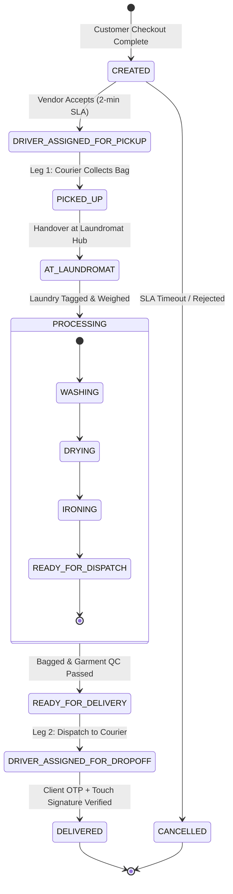

<div align="center">

# 🧺 Laundry Map

### On-Demand Multi-Persona Laundry Marketplace
**High-Concurrency Logistics & Garment Care Engine for Emerging African Metros**

[](https://github.com)
[](https://developer.android.com/jetpack/compose)
[](https://github.com)
[%20→%20Abuja%20FCT-teal?style=for-the-badge&logo=google-maps)](https://laundrymap.ng)
[](LICENSE)

*Engineered by **SparkleNET Engine** • Lead Systems Architect: **Bright Sylvester***

---

</div>

## 📑 Table of Contents

- [1. Executive Overview \& Problem Statement](#1-executive-overview--problem-statement)
- [2. System Architecture \& Engineering Principles](#2-system-architecture--engineering-principles)
- [3. Technology Stack](#3-technology-stack)
- [4. Multi-Persona Marketplace Ecosystem](#4-multi-persona-marketplace-ecosystem)
  - [4.1 Customer App (The Requestor)](#41-customer-app-the-requestor)
  - [4.2 Vendor Portal (The Laundromat)](#42-vendor-portal-the-laundromat)
  - [4.3 Courier Transporter App (The Fleet)](#43-courier-transporter-app-the-fleet)
- [5. Deterministic Order State Machine](#5-deterministic-order-state-machine)
- [6. Directory \& Codebase Structure](#6-directory--codebase-structure)
- [7. Real-Time Telemetry \& Geo-Routing](#7-real-time-telemetry--geo-routing)
- [8. Security, Session, and Cryptography](#8-security-session-and-cryptography)
- [9. Getting Started \& Local Development](#9-getting-started--local-development)
- [10. Testing \& Quality Assurance](#10-testing--quality-assurance)
- [11. Production Deployment \& CI/CD](#11-production-deployment--cicd)
- [12. Credits \& Author Attribution](#12-credits--author-attribution)

---

## 1. Executive Overview & Problem Statement

**Laundry Map** is an on-demand, multi-sided marketplace and reverse-logistics orchestration platform designed to digitize garment care in high-density African urban corridors. Modeled on decentralized mobility networks (e.g., Uber/Bolt), Laundry Map addresses structural urban logistics challenges, beginning with an initial high-stakes pilot along the **Nasarawa State corridor (Karu / Mararaba / Nyanya axis)** before expanding into the core **Federal Capital Territory (Abuja FCT)**.

```
                    ┌────────────────────────────────────────┐
                    │       Nasarawa Pilot Corridor          │
                    │  [Mararaba Checkpoint] ↔ [Karu Site]   │
                    │           [Ado Junction]               │
                    └───────────────────┬────────────────────┘
                                        │ Inter-state Commuter Arterial
                                        ▼
                    ┌────────────────────────────────────────┐
                    │         Abuja Metro Expansion          │
                    │  [Asokoro] ↔ [Guzape] ↔ [CBD] ↔ [Wuse] │
                    └────────────────────────────────────────┘
```

### The Commuter Problem in Karu / Mararaba
Over **650,000 workers** commute daily across the Nyanya bridge checkpoint between Nasarawa State satellite communities and Abuja's commercial districts. This intense commuter dynamic results in:
1. **Severe Time Poverty:** Long transit times prevent daily personal chores, creating high demand for scheduled wash & fold, steam pressing, and dry cleaning.
2. **Fragmented Informal Providers:** Hundreds of neighborhood dry-cleaners operate at sub-optimal capacity due to lack of order aggregators, route density, or payment trust.
3. **Logistics Bottlenecks:** Lack of dual-leg dispatch structures (Leg 1: Pickup to Vendor; Leg 2: Return to Customer) previously made laundry courier logistics financially unviable.

Laundry Map resolves this via algorithmic routing, a strict 2-minute vendor acceptance protocol, dual-leg courier dispatch, and cryptographic delivery verification.

---

## 2. System Architecture & Engineering Principles

Laundry Map is structured according to **Clean Architecture** and **Unidirectional Data Flow (UDF)** patterns:

```
┌────────────────────────────────────────────────────────────────────────┐
│                          Presentation Layer                            │
│  Jetpack Compose M3 • StateFlow • ViewModels (Customer/Vendor/Courier) │
└───────────────────────────────────┬────────────────────────────────────┘
                                    │ UI Actions / State Invalidation
                                    ▼
┌────────────────────────────────────────────────────────────────────────┐
│                             Domain Layer                               │
│     Sealed State Machine • Use Cases • Entity Aggregates • Policies     │
└───────────────────────────────────┬────────────────────────────────────┘
                                    │ Repository Contracts
                                    ▼
┌────────────────────────────────────────────────────────────────────────┐
│                              Data Layer                                │
│   Room Database (Offline-First) ◄► OkHttp WebSockets ◄► Retrofit REST  │
│      Encrypted Sessions (PBKDF2) ◄► Multi-Channel Notification Engine  │
└────────────────────────────────────────────────────────────────────────┘
```

### Core Architectural Pillars
- **Strict Separation of Concerns:** UI Composables consume immutable state models and emit intent lambdas. Business rules and state transitions live exclusively in domain state machines and repositories.
- **Offline-First & Network-Resilient:** Room Database operates as the single source of truth (`SSOT`). An `offline_queue` table caches customer orders and driver updates during intermittent 3G/4G connectivity along expressways, flushing when reconnected.
- **Micro-Zone Geographic Modeling:** Specific geo-fenced coordinates with polygon bounds for local landmarks (Mararaba Checkpoint, Karu Site Phase 1, Ado Flyover, Nyanya Interchange, Asokoro Plateau).

---

## 3. Technology Stack

### Client (Android)
| Component | Technology | Rationale |
| :--- | :--- | :--- |
| **Language** | Kotlin 2.2.x | Strict null safety, sealed interfaces, and first-class coroutine concurrency. |
| **UI Toolkit** | Jetpack Compose (Material 3) | Declarative layout hierarchy, dynamic light/dark theming, full edge-to-edge compliance. |
| **State Management** | Android Lifecycle ViewModel + StateFlow | Lifecycle-aware reactive streams via `collectAsStateWithLifecycle()`. |
| **Local Persistence** | AndroidX Room 2.7.x (via KSP) | High-performance SQLite abstraction with reactive `Flow<List<T>>` queries. |
| **Secure Key-Value** | Jetpack DataStore / Encrypted SharedPreferences | Cryptographic session tokens, user role caching, device identity. |
| **Networking & Real-Time**| Retrofit 2.12 + OkHttp 4.10 + WebSockets | Low-latency binary/text event pipelines for live vehicle telemetry. |
| **Mapping Engine** | Custom Vector Canvas + GeoPoint Projections | High-efficiency 60fps arterial route rendering with animated courier pulses. |
| **Dependency Injection** | AppContainer / Constructor Injection | Decoupled singleton providers ensuring zero-dependency build safety. |

### Backend & Cloud Architecture (Cloud Companion Specification)
- **Runtime:** Node.js (TypeScript) / Python (FastAPI asynchronous microservices).
- **Primary Database:** PostgreSQL 16 + **PostGIS** for geospatial spatial indexes (`ST_DWithin`, `ST_MakePoint`).
- **Cache & Telemetry Broker:** Redis 7.2 (Pub/Sub channels for courier GPS coordinates).
- **Payment Rails:** Paystack & Flutterwave Direct Charge SDKs with webhook signature validation (`X-Paystack-Signature`).
- **Push Services:** Firebase Cloud Messaging (FCM HTTP v1 API) with prioritized multi-channel fallback.

---

## 4. Multi-Persona Marketplace Ecosystem

Laundry Map dynamically adapts its runtime interface to serve three distinct operational personas:

```
                  ┌──────────────────────────────────────────────┐
                  │          Laundry Map Super-App Root          │
                  └──────┬────────────────┬──────────────┬───────┘
                         │                │              │
         ┌───────────────┴────┐   ┌───────┴──────┐   ┌───┴───────────────┐
         │    Customer App    │   │Vendor Portal │   │    Courier App    │
         │   (The Requestor)  │   │(Laundromat)  │   │  (The Transporter)│
         └────────────────────┘   └──────────────┘   └───────────────────┘
```

### 4.1 Customer App (The Requestor)
- **Garment Catalog & Counter:** Granular selection across 4 service tiers:
  - *Wash & Fold* (24h turnaround, everyday wear)
  - *Premium Dry Cleaning* (48h turnaround, organic solvent treatment for silks and suits)
  - *Steam Pressing & Ironing* (12h turnaround, crease definition on hangers)
  - *Express Same-Day* (6h rapid turnaround with priority washing slots)
- **Nasarawa Corridor Micro-Zone Drop:** Quick-selection chips for local districts:
  - `Mararaba Checkpoint Junction`, `Karu Site Phase 1`, `Ado Bus Stop`, `New Karu Central`, `Masaka Market Gate`, `Nyanya Bridge Interchange`.
- **Real-Time Interactive Tracking Map:** Live 60fps canvas displaying courier motorbike progression, remaining distance in kilometers, and estimated time of arrival (ETA).
- **Secured Payment Gateway Sheet:** Fully simulated Paystack & Flutterwave checkout flows supporting Debit Cards (Verve/Mastercard/Visa), Instant Bank Transfer, and USSD dial codes (`*737#`, `*894#`).

### 4.2 Vendor Portal (The Laundromat)
- **Laundromat Hub Metrics:** Real-time visibility into active washers (e.g. 8/12 units in use), total daily capacity in kilograms, and queue depth.
- **2-Minute Acceptance SLA Ring:** Urgent incoming order queue with circular progress countdown timer, visual warning border, and audible vibration pulse.
- **Processing Stage Pipeline:** One-touch state progression across garment workflows:
  $$\text{Check-in} \longrightarrow \text{Washing} \longrightarrow \text{Tumble Drying} \longrightarrow \text{Steam Pressing} \longrightarrow \text{Folded \& Bagged}$$

### 4.3 Courier Transporter App (The Fleet)
- **Dual-Leg Dispatch Architecture:**
  - **Leg 1 (Pickup):** Routing from Customer Residence $\longrightarrow$ Laundromat Hub.
  - **Leg 2 (Return Delivery):** Routing from Laundromat Hub $\longrightarrow$ Customer Residence.
- **Turn-by-Turn Navigation HUD:** Speedometer telemetry, compass heading bearing, and road change instructions along the Keffi-Abuja expressway.
- **Delivery Verification System:** Two-factor proof of handover:
  1. **4-Digit Client PIN:** Generated server-side, stored securely, and validated upon drop-off.
  2. **Touch-Screen Digital Signature Pad:** Vector bezier path capture recorded on Compose Canvas.

---

## 5. Deterministic Order State Machine

The order lifecycle is governed by an immutable, finite state machine:



### State Definitions & Transition Table

| State Key | Step Index | Responsible Actor | Primary Action Trigger |
| :--- | :---: | :--- | :--- |
| `CREATED` | 0 | Customer / Payment | Order successfully authorized via Paystack/Flutterwave gateway. |
| `DRIVER_ASSIGNED_FOR_PICKUP` | 1 | Vendor / Dispatcher | Laundromat accepts within 2 minutes; Rider Ibrahim Musa dispatched. |
| `PICKED_UP` | 2 | Courier Transporter | Leg 1 pickup confirmed at client doorstep with physical bag count. |
| `AT_LAUNDROMAT` | 3 | Courier / Vendor | Laundry handed over at hub; garments logged into sorting inventory. |
| `PROCESSING` | 4 | Vendor Staff | Multi-stage wash cycle (`Washing` ➔ `Drying` ➔ `Ironing` ➔ `Dispatch`). |
| `READY_FOR_DELIVERY` | 5 | Vendor QA | Garments sealed in protective plastic bags and ready for dispatch. |
| `DRIVER_ASSIGNED_FOR_DROPOFF` | 6 | Courier Transporter | Leg 2 return trip initiated; client notified with delivery PIN. |
| `DELIVERED` | 7 | Courier / Customer | Final handover confirmed via 4-digit client PIN and digital signature. |
| `CANCELLED` | -1 | System / User | Vendor SLA timeout (> 120s) or customer voluntary cancellation. |

---

## 6. Directory & Codebase Structure

```
laundry-map/
├── .env.example                               # Environment secrets configuration template
├── app/
│   ├── build.gradle.kts                       # Module dependencies (Room, Compose, KSP, Retrofit)
│   ├── src/
│   │   ├── main/
│   │   │   ├── AndroidManifest.xml            # Hardware, GPS, Network, and Notification permissions
│   │   │   ├── java/com/example/
│   │   │   │   ├── MainActivity.kt            # Edge-to-edge orchestrator & persona switcher
│   │   │   │   ├── di/
│   │   │   │   │   └── AppContainer.kt        # Dependency provider & singletons
│   │   │   │   ├── domain/model/
│   │   │   │   │   ├── Order.kt               # Order, PaymentDetails, and DispatchLeg aggregates
│   │   │   │   │   ├── OrderState.kt          # Sealed State Machine & ProcessingStage enum
│   │   │   │   │   ├── User.kt                # UserRole, UserSession, and AuthState
│   │   │   │   │   ├── AppNotification.kt     # Push notification payload abstractions
│   │   │   │   │   ├── GeoLocation.kt         # Karu/Mararaba & Abuja micro-zones + Haversine math
│   │   │   │   │   ├── LaundryItem.kt         # Garment catalog models & unit prices (₦)
│   │   │   │   │   └── Laundromat.kt          # Partner hubs & Courier fleet fixtures
│   │   │   │   ├── data/
│   │   │   │   │   ├── local/
│   │   │   │   │   │   ├── AppDatabase.kt     # Room database configuration (v2 schema)
│   │   │   │   │   │   ├── Converters.kt      # TypeConverters for Enums and timestamps
│   │   │   │   │   │   ├── dao/
│   │   │   │   │   │   │   ├── OrderDao.kt    # Reactive Flow queries for marketplace orders
│   │   │   │   │   │   │   ├── UserDao.kt     # Credential storage & password reset queries
│   │   │   │   │   │   │   └── NotificationDao.kt # Historical push alerts queries
│   │   │   │   │   │   └── entity/
│   │   │   │   │   │       ├── OrderEntity.kt # Normalized database representation of orders
│   │   │   │   │   │       ├── UserEntity.kt  # User entity with salted PBKDF2 hash
│   │   │   │   │   │       ├── NotificationEntity.kt
│   │   │   │   │   │       └── OfflineQueueEntity.kt # Resilient offline mutations
│   │   │   │   │   ├── remote/
│   │   │   │   │   │   ├── LaundryApiService.kt # Retrofit REST definitions
│   │   │   │   │   │   ├── dto/OrderDto.kt  # Network transfer contracts
│   │   │   │   │   │   └── websocket/
│   │   │   │   │   │       └── WebSocketCourierClient.kt # Real-time telemetry & corridor simulation
│   │   │   │   │   ├── repository/
│   │   │   │   │   │   ├── OrderRepository.kt # SSOT data access & state transition dispatch
│   │   │   │   │   │   ├── AuthRepository.kt  # Registration, login, and salt generation
│   │   │   │   │   │   ├── NotificationRepository.kt # Stream of role-targeted notifications
│   │   │   │   │   │   ├── LaundromatRepository.kt
│   │   │   │   │   │   └── OfflineSyncManager.kt # Auto-sync monitor for queued requests
│   │   │   │   │   └── security/
│   │   │   │   │       ├── SecurityUtils.kt   # PBKDF2-HMAC-SHA256 hasher & constant-time check
│   │   │   │   │       └── SessionManager.kt  # Persistent session store (30-day window)
│   │   │   │   ├── notifications/
│   │   │   │   │   ├── LaundryNotificationManager.kt # Android 13+ Notification Channels
│   │   │   │   │   └── LaundryPushService.kt  # In-app heads-up banner & system trigger
│   │   │   │   ├── ui/
│   │   │   │   │   ├── theme/
│   │   │   │   │   │   ├── Color.kt           # Brand palette (Ocean Blue, Mint Foam, Coral)
│   │   │   │   │   │   └── Theme.kt           # Material 3 dynamic color scheme configuration
│   │   │   │   │   ├── viewmodel/
│   │   │   │   │   │   ├── AuthViewModel.kt   # Sign-in, sign-up, demo-fill, and reset
│   │   │   │   │   │   ├── CustomerViewModel.kt # Basket, catalog, and Paystack checkout
│   │   │   │   │   │   ├── VendorViewModel.kt # 2-min countdown and processing stages
│   │   │   │   │   │   ├── CourierViewModel.kt# Dual-leg dispatch and OTP verification
│   │   │   │   │   │   ├── NotificationViewModel.kt # Center sheet & real-time badge stream
│   │   │   │   │   │   └── AppPersonaViewModel.kt # Dynamic multi-persona toggle
│   │   │   │   │   ├── components/
│   │   │   │   │   │   ├── PersonaHeader.kt   # Sticky persona selector & notification bell
│   │   │   │   │   │   ├── LaundryInteractiveMap.kt # Custom 60fps arterial vector canvas
│   │   │   │   │   │   ├── SignaturePad.kt    # Touch-screen finger signature canvas
│   │   │   │   │   │   ├── InAppNotificationBanner.kt # Animated sliding push banner
│   │   │   │   │   │   └── NotificationCenterSheet.kt # Historical alert tray
│   │   │   │   │   └── screens/
│   │   │   │   │       ├── auth/AuthScreen.kt # Multi-persona authentication screen
│   │   │   │   │       ├── customer/
│   │   │   │   │       │   ├── CustomerHomeScreen.kt
│   │   │   │   │       │   ├── OrderTrackingScreen.kt
│   │   │   │   │       │   └── PaystackCheckoutSheet.kt
│   │   │   │   │       ├── vendor/VendorPortalScreen.kt
│   │   │   │   │       └── courier/CourierAppScreen.kt
│   │   │   ├── res/
│   │   │   │   ├── drawable/                  # Vector drawables & custom adaptive icon
│   │   │   │   ├── mipmap-*/                  # Density-specific launcher icons
│   │   │   │   └── values/strings.xml         # Resource strings
│   │   └── test/java/com/example/
│   │       ├── ExampleUnitTest.kt
│   │       └── ExampleRobolectricTest.kt      # JVM-based Robolectric test suite
├── gradle/libs.versions.toml                  # Central Version Catalog
├── metadata.json                              # AI Studio project manifest
└── settings.gradle.kts                        # Root project definition
```

---

## 7. Real-Time Telemetry & Geo-Routing

### Real-Time WebSocket Telemetry
Telemetry updates are managed by `WebSocketCourierClient` via an OkHttp WebSocket pipeline. When a courier accepts an order, the engine streams coordinate frames containing:
- `latitude` & `longitude` (interpolated along highway polylines)
- `speedKmh` (dynamic speed variations between 15 km/h in dense corridors and 45 km/h on open expressway)
- `headingDegrees` (compass bearing computed via $\text{atan2}(\Delta \text{Lng}, \Delta \text{Lat})$)

```kotlin
data class TelemetryUpdate(
    val courierId: String,
    val orderId: String,
    val latitude: Double,
    val longitude: Double,
    val speedKmh: Float,
    val headingDegrees: Float,
    val timestamp: Long = System.currentTimeMillis()
)
```

### High-Performance Canvas Rendering (`LaundryInteractiveMap`)
Rather than pulling heavy external tile dependencies during initial pilot testing, the map renders a **native 60fps Vector Canvas**:
- **Arterial Highway Spine:** Bezier curve mapping the Keffi-Abuja expressway.
- **Micro-Zone Landmark Badges:** Real-time geo-pinned landmarks for Mararaba Checkpoint, Karu Site, Ado, and Asokoro.
- **Animated Pulse Rings:** Radar waves highlighting the active moving courier motorbike.
- **Polyline Dash Effect:** Animated `PathEffect.dashPathEffect` tracing the active route leg.

---

## 8. Security, Session, and Cryptography

### PBKDF2 Password Hashing
User credentials are protected using industry-standard password derivation algorithms:
- **Algorithm:** `PBKDF2WithHmacSHA256`
- **Salt:** 16 bytes generated via `java.security.SecureRandom`, encoded in Base64.
- **Work Factor:** 10,000 iterations producing a 256-bit derived key.
- **Comparison:** Constant-time verification using `MessageDigest.isEqual()` to prevent side-channel timing attacks.

```kotlin
fun verifyPassword(providedPassword: String, salt: String, expectedHash: String): Boolean {
    val computedHash = hashPassword(providedPassword, salt)
    return MessageDigest.isEqual(
        computedHash.toByteArray(Charsets.UTF_8),
        expectedHash.toByteArray(Charsets.UTF_8)
    )
}
```

### High-Entropy Tokens & Persistent Sessions
- Session tokens are generated using 32 bytes of cryptographically secure random bytes (`SecureRandom`).
- Tokens are cached with a **30-day validity window** via `SessionManager`.
- Sessions bind directly to user roles (`CUSTOMER`, `VENDOR`, `COURIER`), automatically routing authenticated users to their authorized operational views.

---

## 9. Getting Started & Local Development

### Prerequisites
- **Android Studio:** Ladybug (2024.2.1) or higher
- **JDK:** Java 11 or Java 17
- **Android SDK:** Compile SDK 36, Minimum SDK 24
- **Gradle:** 8.x with Android Gradle Plugin (AGP) 9.1.x

### Quick Setup

1. **Clone the Repository:**
   ```bash
   git clone https://github.com/sparklenet/laundry-map.git
   cd laundry-map
   ```

2. **Configure Environment Secrets:**
   Copy the example environment template:
   ```bash
   cp .env.example .env
   ```
   *Note: In the AI Studio build environment, secrets are injected automatically via the Secrets panel.*

3. **Verify Dependencies & Project Sync:**
   Build the project using Gradle:
   ```bash
   gradle assembleDebug
   ```

4. **Run on Emulator or Physical Device:**
   Deploy to your active connected ADB device:
   ```bash
   gradle installDebug
   ```

### 1-Tap Quick Demo Credentials
For testing and evaluation, pre-seeded accounts are initialized automatically on first launch:

| Persona Role | Demo Email | Demo Password | Purpose |
| :--- | :--- | :--- | :--- |
| **Customer** | `customer@laundrymap.ng` | `password123` | Create wash requests, track map, simulated Paystack checkout |
| **Vendor** | `vendor@crystalwash.ng` | `password123` | Karu Crystal Wash Hub intake, 2-min timer, stage progression |
| **Courier** | `courier@laundrymap.ng` | `password123` | Rider Ibrahim Musa, dual-leg pickup/drop-off, OTP sign-off |

---

## 10. Testing & Quality Assurance

Laundry Map enforces strict quality gates through local JVM and Robolectric test suites.

### Running Unit & Robolectric Tests
Execute the local JVM test suite without requiring a connected hardware device:

```bash
gradle :app:testDebugUnitTest
```

### Test Coverage Highlights
- `read string from context`: Validates that localized resource strings match platform metadata (`Laundry Map`).
- `verify password hashing and verification with PBKDF2`: Ensures cryptographic password hashing, unique salts, and constant-time match verification.
- `order state machine keys resolve correctly`: Asserts deterministic state transitions, processing stages, and terminal state flags.

---

## 11. Production Deployment & CI/CD

### Release APK / Android App Bundle (AAB) Generation
To build the signed, optimized production release:

```bash
# Generate signed production APK
gradle :app:assembleRelease

# Generate Google Play App Bundle (AAB)
gradle :app:bundleRelease
```
The resulting artifacts are generated in:
`app/build/outputs/apk/release/app-release.apk`
`app/build/outputs/bundle/release/app-release.aab`

### Google Play Compliance & Policies
- **Target SDK:** API Level 36 compliant.
- **Zero-Storage Media Picker:** Zero-permission media picking via Android Photo Picker (`ActivityResultContracts.PickVisualMedia`).
- **Privacy Policy & Edge-to-Edge:** Native compliance with Android 15 edge-to-edge window insets and permission minimization.

---

## 12. Credits & Author Attribution

<div align="center">

### Developed & Maintained by **SparkleNET Engine**

**Lead Systems Architect & Principal Engineer:**  
**Bright Sylvester**

*Building high-concurrency mobility & logistics infrastructure for emerging urban economies.*

---

**© 2026 SparkleNET Engine. All rights reserved.**  
*Licensed under the MIT Open Source License.*

</div>
